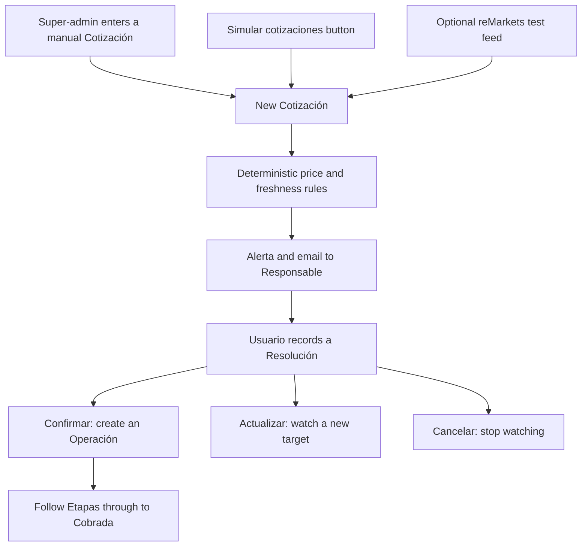

# ShipAgro

**Grain deal follow-up and price alerts for Argentine grain businesses.**

ShipAgro helps corredoras, acopios and cooperativas answer two questions: **what needs my attention today, and which Contactos should I call because their target price has been reached?** It brings Contactos, Operaciones, responsibilities and price alerts into one Spanish-language workspace.

**[Open the hackathon demo →](https://shipagro.vercel.app/admin)**

Reviewers can test the app entirely in a browser. No installation, A3 account or local database is needed. Start with the [guided walkthrough](#guided-walkthrough-10-15-minutes).

ShipAgro **does not place orders, negotiate or execute trades**. An Alerta prompts a person to contact someone and record a decision. Confirming it creates an internal Operación to follow up, not an order on an exchange.

## What you can evaluate

| Capability | What it demonstrates |
|---|---|
| Contactos | A shared directory of Productores, acopios, cooperativas, exportadoras and other business contacts within an Empresa. |
| Operaciones | Follow a grain deal from Concertada through delivery, settlement and payment, with a Responsable and Plazo. |
| Precios gatillo | Watch an Instrumento for a Contacto's desired sale or purchase price. |
| Alertas and Resolución | Notify when a price is near or reached, then let a person confirm, change the target or cancel. |
| Mis pendientes | Put reached-price Alertas ahead of overdue Etapas, Etapas due today, near-price Alertas and remaining work. |
| Empresa isolation and roles | Keep each Empresa's business records separate; Administradores also manage their Usuarios. |
| History and CSV import/export | Inspect changes to Operaciones, Precios gatillo and Alertas, and bring existing Contactos and Operaciones in from a spreadsheet. |

### Terms used in the interface

The UI is in Spanish. These are the terms you will see during the demo:

| Term | Meaning |
|---|---|
| Empresa / Usuario | A grain business / a person who logs in to work for it. |
| Contacto | A person or company the Empresa does business with; not a login. |
| Operación / Etapa | A grain deal / its current follow-up stage. |
| Responsable / Plazo | The Usuario responsible for the work / its due date. |
| Instrumento / Cotización | A market contract being watched / an observed price and time. |
| Precio gatillo / Precio objetivo | A Contacto's request to be alerted / the target price. |
| Alerta / Resolución | A near-price or reached-price notice / the recorded human decision. |
| Pendiente | An Operación's current Etapa or an Alerta requiring attention. |

See the [full glossary](GLOSSARY.md) for the domain model.

## Demo access

Open **https://shipagro.vercel.app/admin**. The demo accounts below all use password **`demo1234`**.

| Email | Usuario | Empresa | Role |
|---|---|---|---|
| `bruno@pampa.test` | Bruno Castro | Corredora Pampa SA | Comercial — start here |
| `ana@pampa.test` | Ana Ferreyra | Corredora Pampa SA | Administrador |
| `diego@norte.test` | Diego Paz | Acopio del Norte SRL | Comercial |
| `carla@norte.test` | Carla Ruiz | Acopio del Norte SRL | Administrador |
| `admin@shipagro.test` | Admin ShipAgro | All Empresas | Super-admin — manual price entry and every Empresa |

Use a normal browser window for Bruno and a private/incognito window for the super-admin. Two tabs in the same browser session share a login.

**This is a shared demo, not a private workspace.** Use fictitious data only. Do not change the demo passwords, delete other reviewers' records or reset the database. Give your test Contacto a distinctive name, such as `Revisión Alex 14:30`, so you can find your own results.

The seed dataset contains two Empresas, 15 Contactos, nine Operaciones across the Etapas and four Precios gatillo. Previous reviewers may have changed them, so the walkthrough creates a new Contacto and Precio gatillo instead of relying on an untouched seed.

## Guided walkthrough (10-15 minutes)

### 1. See what needs attention

1. Log in as **`bruno@pampa.test`**.
2. On the home dashboard, inspect the market card, **Cartera de Contactos**, **Alertas abiertas** and **Mis pendientes**.
3. Open **Operaciones** and **Contactos** from the navigation.

**Expected:** Bruno sees business records for Corredora Pampa SA, not Acopio del Norte SRL. Mis pendientes is personal to Bruno; the collection lists show the Empresa's records, including work assigned to other Usuarios. In an untouched seed, Sofía Bianchi and Juan Pérez have overdue Operaciones assigned to Bruno.

### 2. Create a Contacto and a Precio gatillo

As Bruno:

1. Open **Contactos → Crear nuevo**.
2. Set **Nombre** to your unique reviewer name and **Tipo** to **Productor**, then save.
3. Open **Precios gatillo → Crear nuevo** and enter:

   | Field | Value |
   |---|---|
   | Contacto | The Contacto you just created |
   | Instrumento | `SOJ.ROS/MAY27` |
   | Venta o compra | Venta |
   | Precio objetivo | `325` |
   | Responsable | Bruno Castro |
   | Estado | Activo |
   | Condiciones de entrega | Optional fictitious conditions |
   | Vigencia | Leave empty for this test |

4. Save the Precio gatillo.

**Expected:** it is **Activo**, associated with your Contacto and assigned to Bruno. An existing Cotización does not immediately fire it: it waits for a new qualifying Cotización traded after activation.

### 3. Make the price approach the target

In the private window, log in as **`admin@shipagro.test`**:

1. Open **Cotizaciones → Crear nuevo**.
2. Select **Instrumento** `SOJ.ROS/MAY27`.
3. Set **Precio (último operado)** to **`322`**, **Fuente** to **Manual**, and **Hora de la operación** to the current date and time.
4. Save, then return to Bruno's window and refresh the dashboard.

**Expected:** a **Cerca** Alerta appears for your Contacto. The Precio gatillo remains **Activo**. For a Venta with a target of 325, the near-price threshold is 321.75 (99% of the target).

Create a second new Cotización at `322` with a fresh time if you want to check deduplication: your Precio gatillo should not receive another Cerca Alerta during the same activation.

**Keep this test predictable:** do not press **Simular cotizaciones** during steps 2–5. Its simulated Cotizaciones are shared market data and can also trigger other reviewers' active Precios gatillo on the same Instrumento. Follow the Alerta linked to your own Contacto; another reviewer or a running feed can also advance your trigger.

### 4. Reach the target

As the super-admin, create **another new Cotización** for `SOJ.ROS/MAY27`, this time at **`325`**, with **Fuente → Manual** and a fresh **Hora de la operación**. Cotizaciones are not edited in place.

Refresh Bruno's dashboard.

**Expected:**

- Your Contacto has an **Alcanzado** Alerta.
- Its Precio gatillo is now **Alcanzado**, paused pending a Resolución.
- The reached-price Alerta ranks ahead of overdue Operaciones in **Mis pendientes**.
- No Operación has been created automatically.

Manual prices go through the same alert rules as feed prices, so this path works even when the market is closed.

### 5. Record the human decision

As Bruno, open your Contacto's **Alcanzado** Alerta, set **Resolución → Confirmar**, and save.

**Expected:**

- The Precio gatillo becomes **Confirmado**.
- The Alerta records **Resuelta por**, **Resuelta el** and **Operación creada**.
- The linked Operación is **Concertada**, with your Contacto as Vendedor, Bruno as Responsable, and the grain, currency, observed price and delivery conditions carried over.
- Missing commercial details, such as Comprador and Toneladas, can be filled in by the Usuario.

This records a simulated agreement with the Contacto. It does not send an exchange order.

### 6. Follow the Operación through an Etapa

1. Open the linked Operación.
2. Change **Etapa** from **Concertada** to **Confirmada**, leaving **Responsable** and **Plazo** unchanged, and save.
3. Inspect the saved fields and its version history.
4. Return to the dashboard.

**Expected:** Bruno remains Responsable and the Plazo defaults to two days ahead. The Operación appears in his Pendientes with its new Etapa. Version history lets you inspect the change, and **Modificado por** records the editing Usuario. You can explicitly change the Responsable or Plazo when needed.

The follow-up sequence is:

**Concertada → Confirmada → Registrada → En entrega → Entregada → Precio fijado (only for A fijar) → Liquidada → Cobrada.**

## Optional checks

### Empresa isolation and role permissions

- As Bruno, note your test Contacto's URL. Log out and log in as **Diego** (`diego@norte.test`). Your Pampa Contacto should be absent from Contactos and inaccessible through its direct URL.
- As Diego, inspect **Usuarios**: a Comercial cannot create Usuarios or edit another Usuario.
- As **Ana** (`ana@pampa.test`), inspect Bruno's Usuario record: an Administrador can manage Usuarios in their own Empresa, but cannot grant super-admin access or assign another Empresa. Do not change shared demo credentials or roles.
- As the **super-admin**, use the **Empresa** selector to inspect both Empresas. This is privileged demo access, not the view a Comercial receives.

### Other Resoluciones and Compra alerts

Create a **new Precio gatillo for each test**; a resolved Alerta cannot be resolved again.

| Test | Steps | Expected result |
|---|---|---|
| Update the target | Repeat the Venta test through Alcanzado. Choose **Actualizar precio objetivo**, enter **Nuevo precio objetivo** `330`, and save. Then enter a new manual Cotización at `330`. | The trigger reactivates with the new target, then reaches it on the fresh Cotización. No Operación is created by the update itself. |
| Cancel | Bring a new Precio gatillo to Alcanzado, choose **Cancelar**, and save. | The trigger becomes Cancelado; no Operación is created. |
| Compra | Create a trigger for your Contacto on `TRI.ROS/DIC26`, **Compra**, target `206`, Responsable Bruno. Enter manual Cotizaciones at `208`, then `206`, each with a fresh time. | Cerca, then Alcanzado: Compra watches for a falling price. Confirming creates an Operación with the Contacto as Comprador rather than Vendedor. |
| Reject stale prices | Create a fresh Venta trigger at `325`. Enter a manual Cotización at `325` with a trade time ten minutes in the past. | That Cotización creates no Alerta for the new trigger. A new one with the current time can reach it. |

### Simulated prices

After the manual walkthrough, press **Simular cotizaciones** in the dashboard footer, then refresh. Any Usuario can press it; it needs no A3 credentials and contacts no market-data endpoint.

**Expected:** each Instrumento with an active Precio gatillo gets one new Cotización, one step toward its Precio objetivo: first the *cerca* price (99% of the target for a Venta, 101% for a Compra), then the target itself. The button reports how many Cotizaciones it wrote and how many Alertas you can see. Two presses therefore produce a Cerca Alerta and then an Alcanzado one for the same trigger.

**These are not production market prices.** The dashboard shows simulated mode as **“Precios simulados · Sin conexión a A3”**. Simulated Cotizaciones use the **reMarkets (prueba)** source label, so that label alone does not prove an A3 connection. Manual entries are labeled **Manual**.

### CSV import/export

1. As a Usuario in Pampa, open **Contactos** and choose **Importar** from the list menu.
2. Use a copy of the [Contactos CSV template](docs/import/contactos.csv), keeping its headers and replacing the sample rows with uniquely named fictitious Contactos.
3. Choose **Crea nuevos documentos**, review the preview and start the import.
4. Inspect the result summary, then find the imported Contactos in the list. Try **Exportar** to download them again.

**Expected:** valid rows are created in the selected Empresa; the summary identifies any rows that need correction. Operaciones can also be imported, but relationship fields require existing Contacto and Usuario IDs, not names. See the [CSV import guide and templates](docs/import/README.md) before trying that path.

### Email and history

Alert emails are addressed to the Precio gatillo's Responsable, with the Contacto, Instrumento, price, trade time, source and a link to the Alerta. The demo logins use `.test` addresses, **not reviewer-accessible mailboxes**. Use the in-app Alertas to evaluate the hosted demo; email delivery is not a prerequisite for the walkthrough.

Operaciones, Precios gatillo and Alertas have version history. Inspect it after making an edit to see the saved changes and editing Usuario.

## If a demo step does not behave as expected

| Symptom | What to check |
|---|---|
| Cannot sign in with a demo account | Recheck the address and password above. If they still fail, ask the project team to restore demo access; do not create or reset shared accounts. |
| Cannot create a Cotización | Use the super-admin account in a separate browser session. **Nuevo precio gatillo** and **Simular cotizaciones** are available to every Usuario; entering a Cotización by hand is not. |
| No Alerta after entering a price | Confirm the Instrumento matches, the trigger is Activo, and the trade time is after activation and no more than five minutes old. Check that Vigencia has not passed and the price is within the Instrumento's daily limits, when present. |
| The trigger is already Alcanzado, Confirmado or Cancelado | Another test may have advanced it. Create a fresh trigger for your own Contacto rather than reusing a resolved one. |
| Dashboard appears unchanged | Refresh the page; the other browser window does not update automatically. Use the Alertas list to find your own Contacto if the dashboard is busy. |
| Precios sin actualizar | The last simulated or polled price is over two minutes old. Press **Simular cotizaciones**, or use a fresh manual Cotización. **Mercado cerrado** only appears in the opt-in live feed mode. |
| Login page or app returns an error | Record the page URL, time and visible error and share them with the project team. Reviewers should not need database access to recover the hosted demo. |

## How it works

The app uses **Next.js 16, React 19, Payload CMS 3.92 and PostgreSQL**. Payload's Spanish-language admin panel is the product UI, not a separate back-office screen.



- **Explainable rules, not AI:** Venta reaches its target at or above it; Compra at or below it. Cerca is within 1% on the approaching side, once per activation. Reached triggers pause until a human records a Resolución.
- **Freshness checks:** trades must be after activation, no more than five minutes old, positive and within daily price limits when available. Expired or inactive triggers do not fire.
- **Empresa isolation:** business records carry an Empresa, with access enforced in Payload through the multi-tenant plugin and role rules. Instrumentos and Cotizaciones are shared market data.
- **Three price entry points:** the **Simular cotizaciones** button writes a simulated Cotización locally; the super-admin can enter one by hand; `pnpm feed` polls the optional reMarkets test feed. All three write Cotizaciones through the same alerting hooks.

### MVP boundaries

This is a hackathon MVP, not a production trading system. It does not include automated trading, AI-generated decisions, email ingestion, WhatsApp, spreadsheet synchronization, billing or a mobile app. CSV import is a one-time import, not a live connection to a spreadsheet.

The optional A3 integration connects to **reMarkets, a test environment**, not production market data. Production access and redistribution licensing remain future work. The feed does not recover price crossings missed during an outage, and its market-hours indicator does not account for holidays.

## Optional: run your own local copy

**Not needed to review the hosted demo.** Use this only if you want an isolated database or want to inspect the implementation.

Prerequisites: Node.js **24.22.1+** (or a supported Node 22 release per `package.json`), **pnpm 12.15.0**, and Docker with Compose.

```sh
git clone https://github.com/erikenz/shipagro.git
cd shipagro
cp .env.example .env
# Set PAYLOAD_SECRET in .env to a long random string before continuing.
pnpm install --frozen-lockfile
docker compose up -d
docker compose exec postgres pg_isready -U postgres -d shipagro
```

Wait until Postgres reports that it is accepting connections. Check that `DATABASE_URL` in `.env` points to your **disposable local database**.

**`pnpm seed` deletes existing ShipAgro demo data in the configured database before loading the sample dataset. Never point it at the hosted demo or a database you need to preserve.**

```sh
pnpm seed
pnpm dev
```

Open http://localhost:3000/admin and use the same demo accounts above. The demo needs no feed process: **Simular cotizaciones** writes prices on demand. `pnpm feed` instead runs the continuous poller (the mock A3 client unless `A3_MODE=live`).

For the optional reMarkets connection, add `A3_MODE=live` to your local `.env` and fill `A3_USERNAME` and `A3_PASSWORD` using credentials from [reMarkets](https://remarkets.primary.ventures/) under **Mi Cuenta → Datos Usuario**. Restart the web and feed processes after changing the environment. Despite the mode name, this still uses the reMarkets **test** endpoint by default.

For local email inspection, configure the SMTP variables in `.env.example`, or use the Ethereal test inbox credentials logged by Payload when SMTP is not configured. The web and feed processes may have different test inboxes. Never commit real credentials.

The project's code check is:

```sh
pnpm typecheck
```

## Further reading

- [Glossary](GLOSSARY.md) — business terms and their meaning.
- [Architecture](docs/architecture.md) — domain model, trigger rules and Pendientes ranking.
- [Architecture decisions](docs/adr/) — Empresa isolation and deterministic rules.
- [CSV import guide](docs/import/README.md) — templates, field values and relationship IDs.
- [Seed-based presenter script](docs/demo.md) — a shorter walkthrough for a freshly seeded local instance.
- [A3 API research](docs/research/a3-mercados-apis.md) — integration facts, sources and licensing questions.
