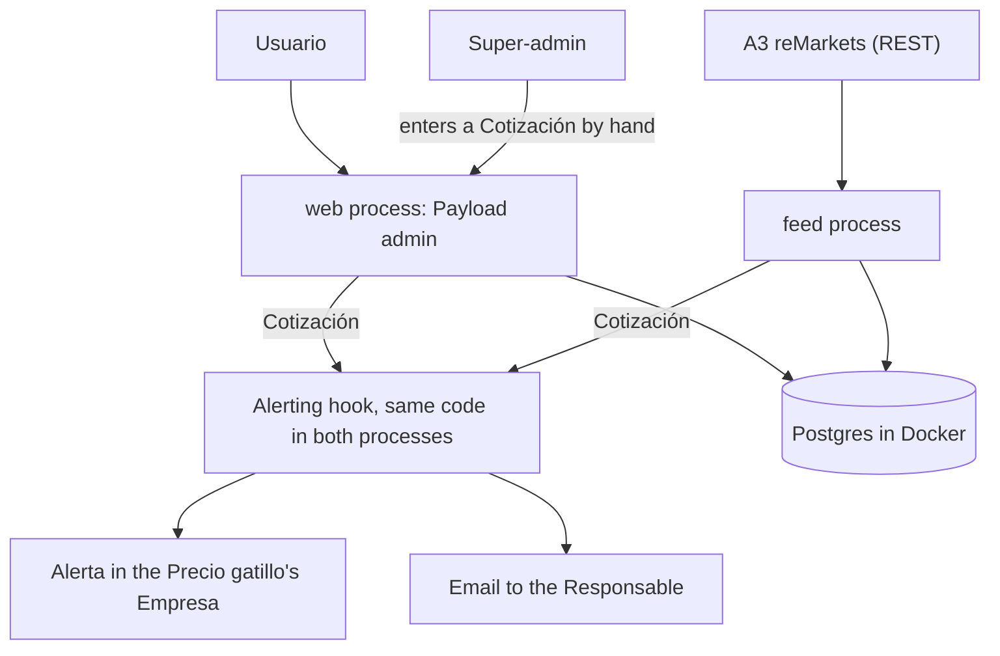
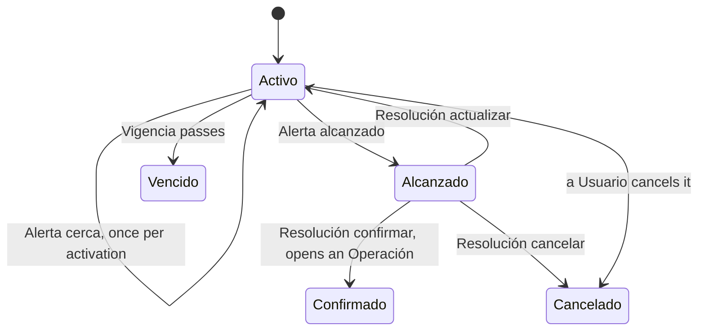

# ShipAgro MVP architecture

Agreed in the design session of 2026-10-24 for a hackathon MVP. Terms follow [GLOSSARY.md](../GLOSSARY.md), lasting decisions are in [adr/](adr/), and A3 facts with sources are in [research/a3-mercados-apis.md](research/a3-mercados-apis.md).

## Scope

**In:**

- RF02, RF04–RF07, RF09–RF11.
- RF01 as a one-time CSV import, using Payload's import-export plugin run synchronously.
- RNF01/RNF02 through Empresas and roles, RNF03 through the trigger rules below, RNF04 through version history.

**Out:** RF03 (reading emails), RF08 (message drafts; no AI for now), WhatsApp, billing and seat limits, Excel/Sheets sync and XLSX, recovering triggers crossed during a feed outage, daily digest, price charts, mobile app, deployment, and production A3 access and data licensing.

## Shape

- **One repo:** Next.js + Payload 3.92 with `@payloadcms/db-postgres`, `@payloadcms/plugin-multi-tenant`, `@payloadcms/plugin-import-export` and `@payloadcms/email-nodemailer`. The admin is in Spanish; code identifiers are in English.
- **Two processes, run locally for now:**
  - `web` (`pnpm dev`): the Payload admin, which is the only UI.
  - `feed` (`pnpm payload run src/feed/run.ts`): polls A3 and writes Cotizaciones. It runs on its own because it has to keep going regardless of web requests and hot reloads.
- **Database:** Postgres in a local Docker container while we build, so the schema and data can change freely. The production host is chosen with deployment; Supabase is the likely pick, used only as a database ([ADR 0001](adr/0001-tenant-isolation-in-payload.md)).
- **Not used:** a jobs queue, Redis, a separate frontend, LLMs.

## Data

| Term | Collection | Scoped to an Empresa | Main fields |
|---|---|---|---|
| Empresa | `tenants` | — | name |
| Usuario | `users` | through its `tenants` array | name, email, role per Empresa (administrador, comercial), super-admin flag |
| Contacto | `contacts` | yes | type (productor, acopio, cooperativa, exportadora, industria, otro), name, CUIT, phone, email, locality |
| Operación | `operations` | yes | Vendedor, Comprador (optional until known), grain, tonnes, price, currency, delivery conditions, a fijar flag, Etapa, Responsable, Plazo |
| Precio gatillo | `price-triggers` | yes | Contacto, Instrumento, side (venta, compra), Precio objetivo, delivery conditions, Responsable, Vigencia, status, activated at, cerca sent at |
| Alerta | `alerts` | yes | Precio gatillo, Cotización, kind (cerca, alcanzado), Resolución, resolved by and at |
| Instrumento | `instruments` | no: shared market data | A3 symbol, grain, delivery month, currency, daily price limits |
| Cotización | `quotes` | no | Instrumento, price, traded at, bid, offer, source (reMarkets, manual) |
| — | `feed-status` (global) | no | last successful poll, last error |

- Version history is on for Operaciones, Precios gatillo and Alertas. Payload 3 has no built-in authorship, so one shared hook sets `updatedBy` and the history shows who changed what (RF10).
- Only the feed and the super-admin write Instrumentos and Cotizaciones. Version history is off for both.

## Modules

Each module keeps a small interface over the work it hides.

| Module | Interface | Hides |
|---|---|---|
| Feed (`src/feed/`) | `runFeed(payload)`: runs until stopped, writes a Cotización whenever an Instrumento's last trade changes, keeps `feed-status` current | reMarkets login and the daily token renewal; the daily Instrumento refresh (agro segment `DDA`, filtered to Rosario USD futures, with daily price limits); the one-request-per-second rotation over Instrumentos with an active Precio gatillo; retries. All A3 URLs and JSON stay in one thin client. |
| Trigger rules (`src/alerts/evaluate.ts`) | `evaluate(trigger, quote, now)` returns none, cerca or alcanzado | The rules below. A pure function, unit-tested directly. |
| Alerting (`afterChange` hook on `quotes`) | Runs for every new Cotización, in whichever process wrote it | Finds the active Precios gatillo on that Instrumento across Empresas, evaluates each, saves the Alerta in the trigger's Empresa, updates the trigger's status, emails its Responsable. |
| Resolución (hook on `alerts`) | Setting the Resolución on an Alerta alcanzado | confirmar: closes the trigger and opens an Operación in Etapa Concertada, prefilled from it; actualizar: a new Precio objetivo, watched from now; cancelar. Records who and when. |
| Pendientes (`src/pendientes.ts`) | `listPendientes(payload, user)` returns a ranked list | The ranking below. |
| Dashboard (admin `beforeDashboard` components) | The admin home page | Mis pendientes, open Alertas, feed status and "mercado cerrado". |

The seam that matters is writing a Cotización. It has two adapters, the feed and the super-admin's manual entry, and everything after it is shared. That is why the demo works with the market closed, and what the alerting tests use.

## Trigger rules

A Cotización can move a Precio gatillo only if all of these hold:

1. The Precio gatillo is active and its Vigencia hasn't passed.
2. The trade happened after the trigger was activated (created, or last given a new Precio objetivo) and is at most 5 minutes old.
3. The price is above zero and within the Instrumento's daily limits.

Then, for a venta (a compra mirrors it):

- Price ≥ Precio objetivo: an Alerta alcanzado, and the trigger pauses until a Resolución.
- Price ≥ 99% of the Precio objetivo: an Alerta cerca, at most once per activation.

The price is the last traded price (`LA`). Bid and offer go in the email for context only. Cotizaciones entered by hand count and are labeled "manual"; feed ones are labeled "reMarkets (prueba)".

## Pendientes order

1. Alertas alcanzado without a Resolución, oldest first.
2. Overdue Etapas, most overdue first.
3. Etapas due today.
4. Alertas cerca.
5. Everything else, by Plazo.

When an Operación moves to its next Etapa, the Responsable stays the same and the Plazo is set two days ahead. Both are editable.

## Access

- Every Usuario sees and edits all Contactos, Operaciones, Precios gatillo and Alertas of their Empresa. Administradores also manage its Usuarios.
- The super-admin sees every Empresa, manages Empresas and Instrumentos, and is the only one who can enter Cotizaciones by hand.
- Payload 3's Local API skips access control by default. Code acting for a Usuario passes `overrideAccess: false` and the `user`. System code (the feed, the alerting hook, the seed script) scopes every write to an Empresa itself.
- One integration test proves that an Alerta lands in its trigger's Empresa and that its email reaches only that Empresa's Responsable.
- The multi-tenant plugin's `cleanupAfterTenantDelete` is off.

## Alert email

Payload's nodemailer adapter, using SMTP settings from the environment when they are set and ethereal.email otherwise (Payload's development default, which logs preview links to the console). The email is in Spanish and shows the Contacto, the Instrumento, the price and trade time, bid and offer, the source label, and a link to the Alerta.

## Feed

- It polls REST snapshots (`/rest/marketdata/get` with entries `LA,BI,OF`) at most once per second, rotating over watched Instrumentos. With 4 Instrumentos, each refreshes every 4 s. Past about 10, switch to the WebSocket.
- reMarkets base URL: `https://api.remarkets.primary.com.ar`. The token comes from `POST /auth/getToken` and lasts 24 h.
- The dashboard shows "mercado cerrado" outside 10:30–17:00 on weekdays, Argentina time (11:00–17:00 from November to March). Holidays aren't handled.
- Outside market hours, expect prices that don't move; the demo then uses Cotizaciones entered by hand.

## Local setup

Steps are in the [README](../README.md). Postgres runs from `docker-compose.yml`; `pnpm dev` and `pnpm feed` are the two processes; `pnpm seed` loads 2 Empresas with 2 Usuarios each. The demo-grade dataset (about 15 Contactos, 8 Operaciones across Etapas and 4 Precios gatillo) belongs to the "Datos y acceso" feature. How the four features split the code is in [AGENTS.md](../AGENTS.md).

## Later

- Deployment: two long-lived processes (the feed can't run on a serverless host) and a hosted Postgres, likely Supabase through its session pooler.
- Production A3 access and data licensing ([research §8](research/a3-mercados-apis.md#8-open-questions-for-a3-sales-and-support)).
- The WebSocket feed, and using `getTrades` to recover triggers crossed during an outage.
- RF03 through forwarded emails (where a decision model like Jev fits), RF08, WhatsApp.
